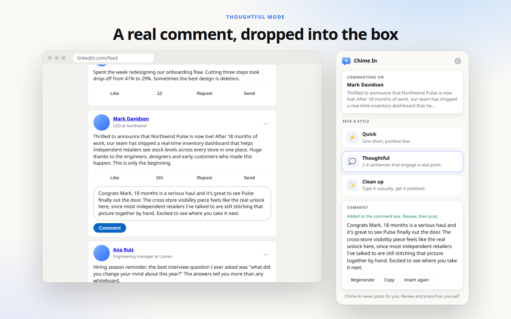
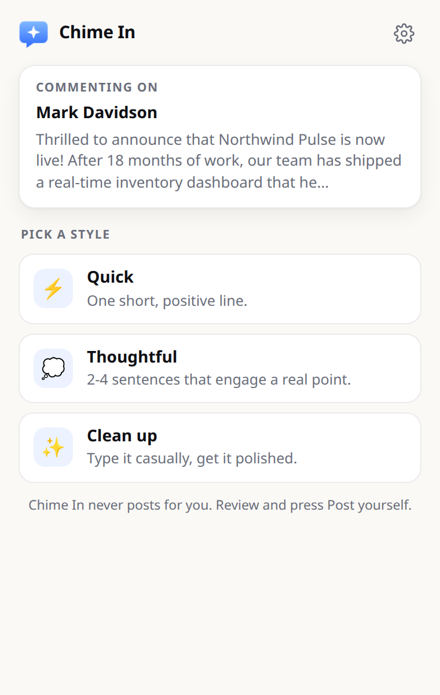
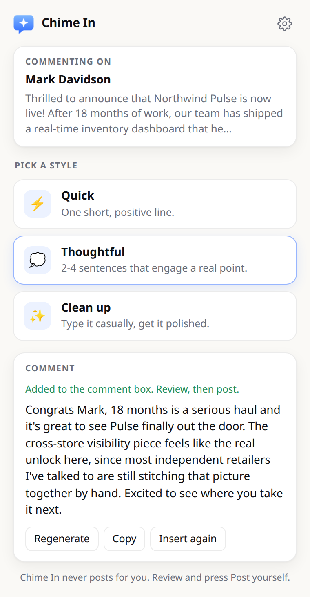

<p align="center">
  
</p>

<h1 align="center">Chime In</h1>

<p align="center">
  <b>Your boss just posted. Chime in with one click.</b><br>
  A Chrome extension that writes a LinkedIn comment and drops it into the post's comment box.<br>
  You read it, tweak it, and hit Post. It never posts for you.
</p>

<p align="center">
  <a href="https://chime-in-ruddy.vercel.app">Website</a> ·
  <a href="#install">Install</a> ·
  <a href="#modes">Modes</a> ·
  <a href="#privacy">Privacy</a>
</p>

<p align="center">
  
</p>

---

## How it works

1. Scroll to a post on LinkedIn (or click into its comment box).
2. Click the Chime In icon in your toolbar, or press <kbd>Alt</kbd>+<kbd>Shift</kbd>+<kbd>C</kbd>.
3. Pick a mode. The comment is written and typed into that post's comment box.
4. Read it, edit if you want, and press **Post** yourself.

## Modes

| Mode | What it does | Example |
| --- | --- | --- |
| ⚡ **Quick** | One short, positive, slightly vague line. | *"Great to see this come together, congrats to the whole team."* |
| 💭 **Thoughtful** | 2–4 sentences that pick up a real point from the post and connect it to something. | *"Eighteen months is a long haul, and shipping a single view of stock across stores feels like the kind of problem that only gets harder the longer you wait…"* |
| ✨ **Clean up** | You type what you mean, however you'd say it. It comes back polished. | `yo this is sick congrats bro, we been needin this fr` → *"Congrats, Mark. This is a huge milestone, and honestly it's something we've needed for a long time."* |

**Make your own.** In Settings you can edit the prompt behind every mode, hide the built-ins, and add as many custom modes as you like, for example "Witty", "Ask a question", or "Hype the team". Each one can optionally ask you for input first. There's also an "About me" field so every comment sounds like you, plus toggles to keep emojis and hashtags out.

<p align="center">
  
  &nbsp;&nbsp;
  
</p>

## Bring your own key

Chime In has no backend and no account. It calls [OpenRouter](https://openrouter.ai) directly from your browser with **your** API key.

- Default model: **`deepseek/deepseek-v4.1-flash`**. A comment costs a tiny fraction of a cent.
- You can swap in any OpenRouter model id in Settings.
- Get a key at [openrouter.ai/keys](https://openrouter.ai/keys). Setting a spend limit on the key is a good idea.

## Install

**Chrome Web Store:** coming soon.

**From source (2 minutes):**

1. Clone this repo.
2. Open `chrome://extensions` and turn on **Developer mode**.
3. Click **Load unpacked** and pick the `extension/` folder.
4. Pin Chime In, open its Settings, and paste your OpenRouter key.

## Privacy

- No analytics, no tracking, no developer servers.
- Your key and settings live in `chrome.storage.local` on your device.
- When you click a mode, the text of that one post (and anything you typed) goes straight from your browser to OpenRouter to generate the comment. Nothing else is read or sent.
- It only ever clicks LinkedIn's **Comment** button to open the comment box. It never clicks Post.

Full policy: [chime-in-ruddy.vercel.app/privacy](https://chime-in-ruddy.vercel.app/privacy)

## Project layout

```
extension/          The Chrome extension (Manifest V3, plain JS, no build step)
  manifest.json
  background.js     Calls OpenRouter, then asks the content script to insert
  content.js        Finds the target post, opens its comment box, inserts text
  popup.*           Toolbar popup: post preview, mode picker, result
  options.*         Settings: key, model, voice, editable/custom modes
  lib/              Shared defaults and storage helpers
  test/             Mock LinkedIn page + Playwright end-to-end test
site/               Landing page (static, deployed on Vercel)
store/              Chrome Web Store screenshots, promo tile, listing copy
scripts/            Icon rendering, store asset generation, zip packaging
```

## Development

```bash
npm install
npx playwright install chromium

# End-to-end test against a mock LinkedIn page, using real OpenRouter calls.
# Needs OPENROUTER_API_KEY in .env
npm test

npm run icons    # re-render icons from scripts/logo.svg
npm run store    # regenerate Web Store screenshots
npm run zip      # build dist/chime-in-<version>.zip for upload
```

LinkedIn changes its markup often. Every selector the extension relies on is in one `SELECTORS` object at the top of [`extension/content.js`](extension/content.js), so fixing a break is usually a one-line change.

## License

MIT. Not affiliated with or endorsed by LinkedIn.
